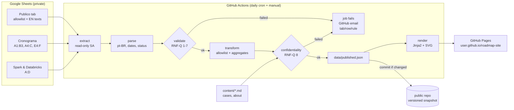

# roadmap-site

roadmap-site is a public static site that shows a study roadmap from **Senior Data Engineer** to **AI Data Engineer**: competencies, courses, projects, weekly study hours and the cases behind each project.

The content is generated once a day from a private Google Sheet by a Python pipeline. The pipeline reads only the ranges it is allowed to read, validates them, keeps only the rows explicitly marked for publication, writes a JSON snapshot and renders a static HTML site with Jinja2 (no JavaScript). The site is published with GitHub Pages.

If any validation or confidentiality check fails, nothing is published: the last valid version stays online and GitHub sends a failure notification.



## Run locally with the synthetic fixture

The repository ships only synthetic data. You can build the whole site locally without any Google credentials:

```bash
pip install -e ".[dev]"
pytest -q
roadmap build --source fixture --fixture tests/fixtures/valid.json --config tests/fixtures/site.yaml --guardrails tests/fixtures/guardrails.yaml --content tests/fixtures/content --out dist --today 2027-02-01
```

The generated site is written to `dist/`. Open `dist/index.html` in a browser.

## Publishing setup

The scheduled workflow (`.github/workflows/publish.yml`) reads the real sheet. It needs three GitHub Actions secrets, set under **Settings → Secrets and variables → Actions**:

| Secret | What it holds |
|---|---|
| `GOOGLE_SA_JSON` | The JSON key of a Google Cloud service account with no project roles. The service account only has read access to the sheet. |
| `SHEET_ID` | The ID of the private Google Sheet (the part of the URL between `/d/` and `/edit`). |
| `FORBIDDEN_TERMS` | One term per line. The build fails if any published text contains one of them (case-insensitive, accents ignored, whole words only). |

Other setup steps:

- Share the Google Sheet with the service account's email address as **Viewer** (read-only). Do not grant more.
- In the repository, go to **Settings → Pages** and set **Source** to **GitHub Actions**.

Secret values never belong in the repository, in logs or in this README.

## Maintenance

GitHub disables scheduled workflows in public repositories after 60 days without repository activity. The daily snapshot commits count as activity, but only when the published content changes. If the snapshot has not changed for about 50 days, run the publish workflow manually from the **Actions** tab (`workflow_dispatch`) to keep the daily schedule alive.

## Status

Work in progress.

## Leak protection

Nothing reaches the site unless it passes three independent layers (design ADR-09):

| Layer | Command | When |
|---|---|---|
| Pre-deploy scan of every rendered file | `roadmap build` | every publish; blocks the deploy |
| Live-site crawl | `roadmap audit-live` | daily and after every publish (`audit.yml`) |
| Repository + full git history | `roadmap audit-repo` | daily and after every publish |

The scanner is evaluated against a labelled suite (`roadmap eval-leaks`, `evals/leak_cases.yaml`): forbidden terms and their obfuscations (tag splitting, HTML entities, zero-width and fullwidth characters), secrets, personal data, private vocabulary, links, and false-positive guards.
