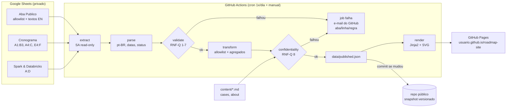

# roadmap-site — Design

> Status: Fase 3, 2026-11-27. Implementa o `spec.md` (R1–R9, RNF-Q 1–8).
> Conteúdo do site em inglês; este documento em português.

## Overview

Um pipeline Python em lote lê a planilha privada (somente leitura e só as colunas permitidas), valida, aplica a allowlist da aba `Publico`, gera um JSON publicado e renderiza um site estático com Jinja2. O pipeline roda no GitHub Actions (cron diário + disparo manual) e publica no GitHub Pages. Se qualquer validação falhar, nada é publicado e o GitHub manda o e-mail de falha.



## Components

Estrutura do repositório (público):

```
roadmap-site/
├── pyproject.toml                 # Python 3.12; deps: google-api-python-client, google-auth,
│                                  # pydantic>=2, jinja2, markdown-it-py, pyyaml; dev: pytest, ruff
├── config/site.yaml               # perfil (nome, título, resumo, links), start_year, chart_min_weeks,
│                                  # base_url, repo_url. Sem segredos.
├── src/roadmap/
│   ├── extract.py                 # lê os ranges permitidos da planilha → RawSheets (em memória)
│   ├── parse.py                   # números pt-BR, datas dd/mm + inferência de ano, status
│   ├── models.py                  # modelos pydantic (raw, parsed, published)
│   ├── config.py                  # SiteConfig + load_config (config/site.yaml)
│   ├── validate.py                # RNF-Q 1–7 → list[Issue]
│   ├── transform.py               # allowlist + cálculos de R1, R3, R4 → PublishedData
│   ├── confidentiality.py         # RNF-Q 8: termos proibidos no conteúdo a publicar
│   ├── chart.py                   # SVG das horas acumuladas por semana (R4)
│   ├── render.py                  # Jinja2 → dist/
│   └── cli.py                     # `roadmap build` (entrypoint)
├── templates/                     # base.html, index.html, case.html, partials/*.html
├── static/style.css               # CSS próprio, sem framework, mobile-first
├── content/
│   ├── about.md                   # texto da seção "How this site works" (R5)
│   └── cases/<project_id>.md      # cases de projetos privados (R2, ADR-05)
├── data/published.json            # snapshot publicado (commitado pelo bot, ADR-07)
├── tests/
│   ├── fixtures/                  # planilhas SINTÉTICAS (nunca dados reais)
│   └── test_*.py
└── .github/workflows/
    ├── ci.yml                     # push/PR: ruff + pytest + build com fixture
    └── publish.yml                # cron + workflow_dispatch: build real + deploy
```

CLI:

```
roadmap build --source sheets|fixture [--fixture PATH] --out dist/ [--snapshot data/published.json]
```
Código de saída: `0` = publicado/gerado; `1` = falha de validação ou de confidencialidade (stderr lista os `Issue`); `2` = erro de infraestrutura (API, credencial).

## Data model

### Extração (minimização na origem, ADR-04)
Leitura com `spreadsheets.values.batchGet`, escopo `https://www.googleapis.com/auth/spreadsheets.readonly`, **só nestes ranges**:

| Range | Conteúdo |
|---|---|
| `Publico!A1:O` | allowlist completa (aba curada, toda pública por definição) |
| `Cronograma!A1:B3` | totais (A=rótulo, B=valor): "Horas planejadas", "Horas concluídas", "Horas não feitas" |
| `Cronograma!A4:C` | cabeçalho `Data, Dia, Curso` + dados (linha da planilha = índice + 4) |
| `Cronograma!E4:F` | cabeçalho `Horas, Status` + dados, alinhado por índice com `A4:C` |
| `'Spark & Databricks'!A1:D` | `Módulo, Tema, Horas, Status` (a coluna E `Observação` **nunca é lida**) |

A coluna `Cronograma!D` (`Atividade`) e a aba `Entrevistas` nunca são lidas. Os ranges de dados começam no cabeçalho (sempre preenchido), porque a API omite linhas vazias no fim de um range; o lado mais curto é completado com linhas vazias. Assim, o que não pode vazar nem chega ao runner.

### Aba `Publico` (nova, criada pelo Lucas): formato longo, uma linha por entidade

Cabeçalho na linha 1, exatamente nesta ordem:

| Col | Nome | Tipo | Obrigatório para | Descrição |
|---|---|---|---|---|
| A | `tipo` | enum | todos | `competencia`, `curso`, `projeto`, `modulo` |
| B | `id` | slug `[a-z0-9-]+` | todos | único dentro do mesmo `tipo` (RNF-Q 6) |
| C | `publicar` | `sim`/`não` | todos | qualquer valor ≠ `sim` (ignorando maiúsculas e espaços) = não publica (R8) |
| D | `ordem` | inteiro | todos | ordem de exibição (crescente) |
| E | `nome_en` | texto | todos | nome em inglês |
| F | `descricao_en` | texto | competencia, projeto | 1–2 frases em inglês |
| G | `competencias` | ids separados por `;` | curso, projeto | competência(s) ligada(s) |
| H | `provedor` | texto | curso | ex. "Data Engineering Academy" |
| I | `cronograma_key` | texto | curso (opcional) | valor **exato** da coluna `Curso` do `Cronograma` (ADR-03) |
| J | `url` | URL https | projeto (público) | link do repositório; vazio = projeto privado → exige `content/cases/<id>.md` |
| K | `credencial_url` | URL https | curso (opcional) | link "View credential" (R3) |
| L | `stack` | lista separada por `;` | projeto | ex. `Python;Airflow;Postgres` |
| M | `pai` | id de curso | modulo | curso ao qual o módulo pertence |
| N | `status_manual` | `Done`, `In progress` ou vazio | curso (opcional) | para curso acompanhado fora do `Cronograma`; força o status. Sem horas, o curso aparece sem horas |
| O | `horas_manual` | número pt-BR, ou `feito/total` | curso com `status_manual` (opcional) | Done: carga total (`70`). In progress: `105/384` (feito/total); número sozinho é inválido |

Para `tipo=modulo`, `id` deve ser `<pai>-m<N>`, onde `N` é o número do módulo na coluna `Módulo` da aba `Spark & Databricks`. É assim que o status é ligado.

### Modelo publicado (`data/published.json`, pydantic `PublishedData`)

```jsonc
{
  "schema_version": 1,
  "data_updated_at": "2026-11-27",          // ADR-07
  "profile": { "name", "headline", "summary", "links": [{ "label", "url" }] },   // de config/site.yaml
  "kpis": {
    "hours_done": 14.0, "hours_planned_total": 120.0, "pct_plan": 11.7,
    "courses_done": 1, "courses_total": 2, "study_start": "2026-11-17"
  },
  "competencies": [{
    "id", "name", "description", "order",
    "status": "Not started|In progress|Done|Planned",
    "pct": 37.5 | null, "hours_done", "hours_planned",
    "courses": ["<course id>"], "projects": ["<project id>"]
  }],
  "courses": [{
    "id", "name", "provider", "competencies": [...], "status": "Planned|In progress|Done",
    "hours_done", "hours_planned", "credential_url": null,
    "modules": [{ "id", "name", "status": "Done|Planned" }]
  }],
  "projects": [{ "id", "title", "description", "stack": [...], "competencies": [...],
                 "repo_url": null, "case_path": "cases/<id>.html" | null }],
  "weekly": [{ "week_start": "2026-11-16", "hours_done_cum": 4.0 }]   // vazio se < chart_min_weeks
}
```
Serialização determinística: `json.dumps(..., sort_keys=True, ensure_ascii=False, indent=2)`, listas ordenadas por (`order`, `id`), floats arredondados para 1 casa.

### Regras de cálculo (ADR-08)
- **Status:** `Feito → Done`, `A fazer → Planned`, `Não feito → Missed`. Linhas Missed são descartadas depois da validação e da reconciliação.
- **Linha pública** do `Cronograma` = `Curso` igual ao `cronograma_key` de algum curso com `publicar=sim` cuja competência (pelo menos uma) também tem `publicar=sim`.
- **Curso:** `hours_done` = Σ Done; `hours_planned` = Σ Done + Σ Planned. Status: Done se `hours_planned > 0` e não há Planned; In progress se `hours_done > 0` e há Planned; Planned caso contrário. `status_manual` (Done ou In progress) sobrescreve tudo (Done: hours_done = hours_planned = `horas_manual` ou 0; In progress com `feito/total`: hours_done = feito, hours_planned = total). Linhas do `Cronograma` de um curso manual não mudam as horas do curso, mas contam no gráfico semanal e em `study_start`.
- **Competência:** soma dos cursos públicos ligados (um curso com N competências soma integralmente em cada uma). `pct = round(100 * done / planned, 1)`; se `planned == 0`, `pct = null` (R1). Status: Done se tem cursos, todos Done, e done = planned; In progress se done > 0, se algum curso ligado já começou (In progress ou Done) **ou** se a competência tem projeto público ligado (prática conta como andamento, mesmo sem horas de curso); Planned se `planned == 0`; Not started caso contrário.
- **KPIs:** somas sobre cursos públicos **distintos** (sem contar duas vezes). `study_start` = `studying_since` do `config/site.yaml` quando preenchido (cursos feitos antes do `Cronograma`); senão, a menor data com linha pública Done.
- **Semanal (R4):** semanas ISO começando na segunda-feira; acumulado de horas Done públicas. Só é gerado se o número de semanas entre a primeira e a última semana com Done (inclusive) for ≥ `chart_min_weeks` (padrão 4).
- **Módulos:** status vem da aba `Spark & Databricks` (`Feito → Done`, outros → Planned), sem horas.

## Flow and orchestration

`publish.yml`:
- Gatilhos: `schedule: cron "0 9 * * *"` (06:00 BRT) e `workflow_dispatch` (R6).
- `concurrency: { group: publish, cancel-in-progress: false }`.
- Permissões: `contents: write` (commit do snapshot), `pages: write`, `id-token: write`.
- Passos: checkout → setup-python 3.12 → `pip install .` → `roadmap build --source sheets --out dist --snapshot data/published.json` → se `data/published.json` mudou, commit pelo `github-actions[bot]` com a mensagem `data: snapshot YYYY-MM-DD` → `actions/upload-pages-artifact` (dist) → `actions/deploy-pages`.
- Se o build sai com código ≠ 0, os passos de commit e deploy não rodam; o Pages continua com a última versão válida (R7). Quando a próxima execução passar, volta ao normal sem intervenção.

`ci.yml` (push e PR): `ruff check`, `pytest`, `roadmap build --source fixture --fixture tests/fixtures/valid.json --out dist`. Nunca usa os segredos.

Reprocessamento e backfill: não há estado próprio. Toda execução recalcula tudo a partir da planilha, e qualquer execução manual equivale a um backfill completo.

## Quality and observability

- **RNF-Q 1–7** em `validate.py`, todas coletadas antes de falhar (o e-mail mostra todos os problemas de uma vez). Cada `Issue` tem `tab`, `row` (número da linha na planilha, começando em 1), `rule` (`Q1`…`Q8`), `message`. A mensagem só pode citar valores das colunas lidas (`Data, Curso, Horas, Status`, colunas da `Publico`, `Módulo, Tema, Horas, Status`) e **nunca** o termo proibido encontrado (cita só o campo e o id).
- Inferência de ano (Q2): começa em `start_year`; o ano avança quando o mês da linha é menor que o mês da linha anterior. Uma data inválida (ex. 31/02) é um `Issue`.
- Reconciliação (Q7): compara com os totais das linhas 1–3, antes de qualquer filtro: `Horas concluídas = Σ Feito`, `Horas não feitas = Σ Não feito`, `Horas planejadas = Σ de todas as linhas`. Fórmula confirmada em 2026-11-27 com os dados reais: Σ das 102 linhas = 133,5 = "Horas planejadas" (K1 resolvido). Tolerância de 0,1h.
- Testes: unitários por módulo com fixtures sintéticas; um teste "golden" compara o `published.json` gerado de `tests/fixtures/valid.json` com `tests/fixtures/expected_published.json`; um teste de determinismo roda o build duas vezes e compara os bytes.
- Observabilidade: o resumo do job (`$GITHUB_STEP_SUMMARY`) mostra contagens (linhas lidas, linhas públicas, issues por regra) e nenhum conteúdo de células não públicas. Falha = e-mail nativo do GitHub Actions (A6).
- Qualidade do site (R9): verificação manual com Lighthouse mobile na T15 (meta ≥ 90 em Performance e Accessibility). O HTML não usa JS, a fonte é do sistema e o CSS é inline/único.

## Security and governance

- **Credencial:** service account do Google Cloud sem papéis no projeto. A planilha é compartilhada com o e-mail da SA como **Leitor**. O JSON da chave fica no GitHub Secret `GOOGLE_SA_JSON` e é lido de variável de ambiente, nunca gravado em disco nem logado. O ID da planilha fica no secret `SHEET_ID`.
- **Termos proibidos:** secret `FORBIDDEN_TERMS` (um por linha). A busca é case-insensitive, depois de normalizar acentos, por palavra inteira (espaço, hífen e underscore dentro do termo são equivalentes: `acme-corp` = `acme corp` = `acme_corp`; variantes coladas como `acmecorp` precisam entrar na lista), sobre todo texto publicado (`published.json` + Markdown de `content/` + `config/site.yaml`). Nos testes, a lista é passada por parâmetro com termos fictícios (`acme-corp`).
- **Repo público:** sem dados brutos, sem fixtures reais, sem `dist/` versionado (`.gitignore`). Os únicos dados versionados são `data/published.json`, que já passou pela allowlist.
- Privacidade: só dados profissionais do Lucas, sem analytics nem cookies.

## Cost estimate

| Item | Custo |
|---|---|
| GitHub Actions (repo público) | R$ 0 (ilimitado para repos públicos) |
| GitHub Pages | R$ 0 |
| Google Sheets API + service account | R$ 0 (bem abaixo da cota) |
| Domínio | R$ 0 no MVP (subdomínio github.io) |
| **Total** | **R$ 0/mês** |

## ADRs

### ADR-01: GitHub Actions + GitHub Pages
- **Contexto:** meta de R$ 0, repo público obrigatório (R5), aviso de falha sem configuração extra (A6), agendamento diário e manual (R6).
- **Opções:** (a) Actions + Pages; (b) Actions + Cloudflare Pages; (c) build na Vercel/Netlify.
- **Decisão:** (a), com subdomínio `github.io`.
- **Consequências:** um único serviço para cron, segredos, alertas e hospedagem. Não há preview por PR (aceitável). Um domínio próprio pode entrar depois só com o arquivo `CNAME`. Ver o risco do cron desativado por inatividade.

### ADR-02: Python + Jinja2, HTML estático sem JS
- **Contexto:** o pipeline é peça de portfólio de Data Engineering; Lighthouse ≥ 90.
- **Opções:** Jinja2; Python + Astro; Streamlit/Evidence.
- **Decisão:** um único projeto Python. O gráfico semanal é SVG gerado em Python (`chart.py`).
- **Consequências:** uma stack só e quase zero JS. O visual depende de CSS próprio, simples e responsivo.

### ADR-03: Aba `Publico` em formato longo como allowlist única, ligação por nome exato
- **Contexto:** R8 (só publica o que está marcado), Q6, Q7. A coluna `Curso` do `Cronograma` tem poucos valores fixos.
- **Opções:** várias abas (`Publico_Cursos`, ...); uma aba longa com `tipo`; chave sintética no `Cronograma`.
- **Decisão:** uma aba `Publico` com coluna `tipo`. Os cursos se ligam ao `Cronograma` pelo valor exato de `Curso` (`cronograma_key`).
- **Consequências:** o Lucas não muda nada no `Cronograma`. Se um `cronograma_key` público não aparece em nenhuma linha do `Cronograma`, isso é só um aviso (curso ainda sem sessões), não um bloqueio. Renomear um curso no `Cronograma` exige atualizar a `Publico`. Valores de `Curso` sem mapeamento ficam de fora por padrão.

### ADR-04: Minimização na extração + segredos no GitHub
- **Contexto:** R8 e A5. O repo e os logs são públicos.
- **Decisão:** ler só os ranges permitidos (a coluna `Atividade`, a coluna `Observação` e a aba `Entrevistas` nunca saem do Google); SA com escopo `spreadsheets.readonly`; `GOOGLE_SA_JSON`, `SHEET_ID` e `FORBIDDEN_TERMS` como GitHub Secrets.
- **Consequências:** é impossível vazar o que não foi lido. Os logs nunca citam o termo proibido encontrado. Testes usam termos fictícios.

### ADR-05: Cases e textos longos em Markdown no repo
- **Contexto:** Q3. O case do `job-search-agent` (repo privado) é texto longo e formatado.
- **Decisão:** `content/cases/<project_id>.md`, renderizado com markdown-it-py em `cases/<id>.html`. O texto de "How this site works" fica em `content/about.md`.
- **Consequências:** o texto tem diff e revisão, mas editar exige commit. O Markdown também passa pela checagem de termos proibidos. Um projeto público sem `url` e sem `.md` bloqueia a publicação (RNF-Q 5).

### ADR-06: Cards por competência
- **Contexto:** Q2; leitura em 1–2 min, muitas vezes no celular.
- **Decisão:** página única: hero (perfil + KPIs), gráfico semanal (se houver), um card por competência (status, barra de %, cursos com módulos em `<details>`, projetos), lista de cursos/certificações, cards de projetos, "How this site works". Uma página `cases/<id>.html` por case.
- **Consequências:** HTML semântico sem JS (`<details>` nativo), fácil de manter acessível.

### ADR-07: Snapshot = `data/published.json` commitado só quando muda
- **Contexto:** retenção de snapshots versionados, idempotência (R6) e data da última atualização (R5).
- **Decisão:** o bot commita `data/published.json` só se o conteúdo mudou. `data_updated_at` = data (UTC, `YYYY-MM-DD`) em que o conteúdo publicado mudou pela última vez: se o JSON recém-gerado, sem `data_updated_at`, for igual ao snapshot anterior, a data anterior é mantida; senão, usa a data de hoje. O site mostra "Data last updated: <data>".
- **Consequências:** com a planilha igual, o JSON e o HTML saem idênticos byte a byte. O histórico do git vira o histórico de versões (diff e rollback via `git revert`).

### ADR-08: `Cronograma` como única fonte de horas; Missed excluído; módulos como checklist
- **Contexto:** o status "Não feito" existe na planilha real. A aba `Spark & Databricks` tem horas (14h/módulo) que divergem do `Cronograma`.
- **Decisão:** horas e % vêm só do `Cronograma`; Missed fica fora dos cálculos e do site; módulos aparecem só com Done/Planned; `status_manual` cobre cursos concluídos antes do plano (ex. FDE). *Revisada pela ADR-10.*
- **Consequências:** uma regra única para todas as competências. As horas do curso podem parecer menores que a carga oficial, porque só contam sessões registradas.

### ADR-10: Cursos fora do `Cronograma` e status da competência (2026-11-27)
- **Contexto:** a competência AI Data Engineering aparecia como Planned (0h), embora já houvesse um curso concluído (AIDE, 70h), um em andamento (FDE, 105 de 384h) e um projeto prático. Nenhum dos dois cursos tem linhas no `Cronograma`, e a ADR-08 só previa `status_manual=Done`.
- **Opções:** (a) lançar as horas desses cursos no `Cronograma` (polui o plano semanal com horas passadas); (b) nova coluna na aba `Publico` para a carga total (muda o range extraído, ADR-04); (c) ampliar `status_manual` para `In progress` e aceitar `feito/total` em `horas_manual`.
- **Decisão:** (c). `status_manual` ∈ {Done, In progress}. `horas_manual`: Done → número (carga total, opcional); In progress → `feito/total` (opcional; número sozinho é inválido; feito ≤ total). Status da competência: Done só com todos os cursos Done; In progress se houver horas feitas, curso começado ou projeto público ligado. Data de início dos KPIs configurável (`studying_since` em `config/site.yaml`).
- **Consequências:** sem mudança no range extraído nem no esquema da planilha. As horas manuais precisam ser atualizadas à mão pelo Lucas (célula `horas_manual` do curso). O "% do plano" passa a misturar horas do `Cronograma` com horas declaradas.

## Risks / Open items

| # | Risco / item | Impacto | Mitigação / próximo passo | Dono |
|---|---|---|---|---|
| K1 | A fórmula de "Horas planejadas" (linha 1) pode não ser Σ de todas as linhas | Reconciliação bloqueia toda publicação | T6 confirma a fórmula com uma sonda local nos dados reais, sem commitar dados; ajustar a regra se necessário | Lucas + main session |
| K2 | O GitHub desativa o cron de repos públicos após 60 dias sem atividade no repo | SLO de 24h quebra em silêncio | Os commits de snapshot (quase diários) contam como atividade. Se ficar mais de 50 dias sem mudança, rodar o workflow manualmente. Registrado no README | Lucas |
| K3 | Renomear um curso no `Cronograma` desliga silenciosamente as horas dele | % cai sem erro | Validação: um curso público com horas já publicadas que some do `Cronograma` gera um `Issue` Q5 (compara com o snapshot anterior) | T7 |
| K4 | Linhas do `Cronograma` fora de ordem quebram a inferência de ano | Datas erradas | Q2 bloqueia data futura > 1 dia (exceto "A fazer") e meses que "voltam" mais de uma vez por ano | T5 |
| K5 | Texto em inglês escrito à mão com erros | Imagem ruim com recrutador | Revisão manual do Lucas na T15 antes de pôr o link no CV | Lucas |
| K6 | A aba `Publico` ainda não existe | Bloqueia o primeiro deploy real | T14: o Lucas cria a aba seguindo o template de `docs/publico-template.csv` | Lucas |
| K7 | Usuário do GitHub e nome final do repo | `base_url` e links | Preencher `config/site.yaml` na T14 | Lucas |

### ADR-09: Defesa em profundidade contra vazamento (2026-11-27)
- **Contexto:** o Lucas pediu a garantia de que nada sensível vá ao ar. A checagem Q8 original só olhava os dados (JSON + Markdown), não o HTML final, o site publicado nem o repositório.
- **Decisão:** três camadas, todas com mensagens que citam só *onde* e *que tipo*, nunca o conteúdo encontrado:
  1. **Pré-deploy** (`roadmap build`): o HTML/CSS renderizado e o snapshot passam por `leakscan`: termos proibidos (secret), padrões de segredo (chaves, tokens, e-mail de service account, URL de planilha), PII (e-mail, CPF, telefone), literais de runtime (ID da planilha, identificadores da SA), vocabulário privado da planilha (`config/guardrails.yaml`), allowlist de links e de tipos de arquivo. Falhou → nada é gravado nem publicado.
  2. **Pós-deploy** (`roadmap audit-live`, workflow `audit.yml` diário e após cada publish): crawler do site no ar com as mesmas regras.
  3. **Repositório** (`roadmap audit-repo`): arquivos versionados + todos os patches e mensagens do histórico (`fetch-depth: 0`).
- **Evals:** `evals/leak_cases.yaml` (59 casos rotulados: termos, ofuscação por tags/entidades/zero-width/fullwidth, segredos, PII, vocabulário, links e falsos positivos), rodados no CI e no audit (`roadmap eval-leaks`). Segredos falsos são escritos em pedaços para o próprio repo passar no audit.
- **Consequências:** normalização mais agressiva (remove caracteres invisíveis; `_` conta como separador), então falsos positivos são possíveis e bloqueiam o deploy, o que é preferível a um vazamento. Nomes de cliente/empregador nunca vão para `guardrails.yaml` (público), só para o secret.
